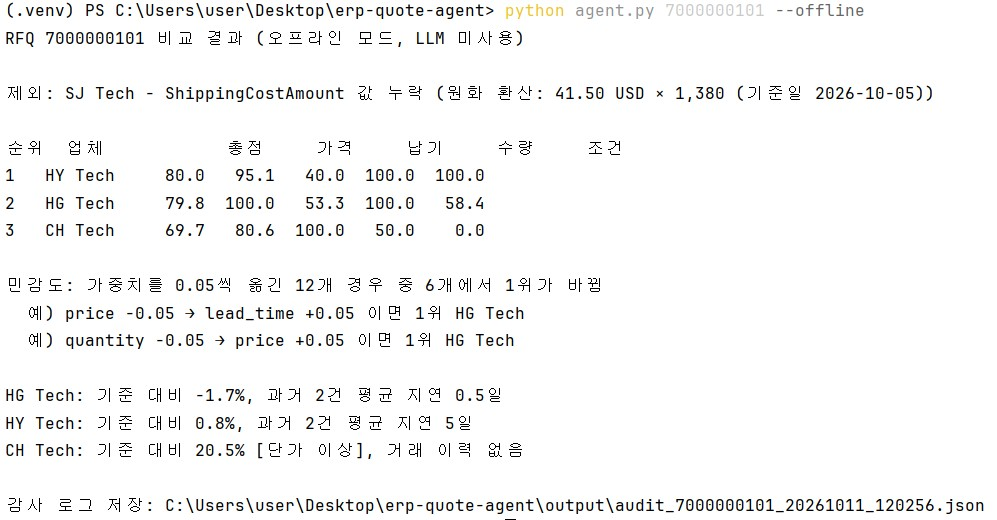
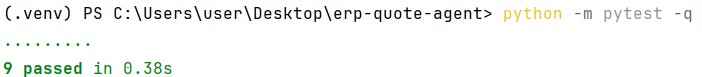

# ERP 견적 비교 에이전트 (프로토타입)

구매팀이 RFQ(견적요청)에 대해 받은 공급업체 견적을 비교하고, 결재 전에 읽을 추천 메모를 만드는 LLM 에이전트입니다.
대학 ERP 연구회에서 SAP S/4HANA로 구매(MM) 프로세스를 실습하며 RFQ 3건의 견적을 가격, 납기, 수량, 조건으로 비교해 공급업체를 선정했던 과정을 출발점으로 삼았습니다.

## 하는 일

```
RFQ 번호 입력
  → get_quotations      ERP 견적 조회 + 데이터 정합성 검증 (통화, 단위, 누락값)
  → score_quotations    4개 항목 점수화, 가중 합산, 가중치 민감도 확인
  → check_price_anomaly 과거 구매 단가 대비 20% 초과 상승 플래그, 납기 지연 이력
  → LLM이 위 결과만 인용해 구매 담당자용 추천 메모 작성
  → 모든 도구 입력과 출력을 감사 로그(output/*.json)로 저장
```

LLM(Claude)은 Function Calling으로 위 세 도구를 직접 골라 호출합니다.

## 설계에서 정한 것과 이유

**1. 숫자는 Python이 계산하고, LLM은 설명만 한다**

구매 결정은 같은 입력에 언제나 같은 결과가 나와야 하고, 나중에 "왜 이 업체였는지" 감사를 받습니다. LLM이 점수를 계산하면 실행할 때마다 값이 달라질 수 있고 근거를 재현할 수 없습니다. 그래서 점수 계산, 검증, 이상 탐지는 전부 `scoring.py`에 두고 테스트로 고정했습니다. 시스템 프롬프트에서도 도구 결과에 있는 숫자만 인용하도록 지시했습니다. 다만 이것은 프롬프트 지시라서, LLM이 숫자를 잘못 옮기는 경우를 코드로 막지는 못합니다.

**2. 비교 전에 데이터부터 거르고, 외화는 기준일 환율로 맞춘다**

샘플 데이터의 SJ Tech 견적은 USD로 들어와 있고 배송비가 비어 있습니다. 처음에는 외화 견적을 전부 제외했지만, 해외 공급업체를 아예 비교에서 빼는 건 구매 실무에 맞지 않아 `data/fx_rates.json`의 기준일 환율로 원화 환산하도록 바꿨습니다. 환산 근거(원래 금액, 환율, 기준일)는 견적과 감사 로그에 함께 남습니다. 환율표에 없는 통화와 필수 값이 빠진 견적은 여전히 제외하고, 제외 사유를 메모 맨 앞에 알립니다. SJ Tech는 원화로 57,270원이라 단가는 가장 낮지만 배송비가 비어 있어 비교에서 빠집니다.

**3. 견적서의 납기를 그대로 믿지 않는다**

처음에는 견적 납기만 점수에 넣었는데, 그러면 HY Tech(약속 5일)가 92.0점으로 HG Tech(80.9점)를 11.1점 앞섰습니다. 구매 이력을 보니 HY Tech는 약속보다 평균 5일 늦게 납품했습니다. 그래서 납기 점수는 "견적 납기 + 해당 업체 과거 평균 지연일"인 실효 납기로 계산합니다. 거래 이력이 없는 업체(CH Tech)는 견적 납기를 그대로 쓰고, 이력이 없다는 사실을 리스크로 따로 보여줍니다.

**4. 점수 차이가 작으면 결정하지 않고 알린다**

실효 납기를 반영해도 1위는 HY Tech지만, 점수는 HY Tech 80.0점, HG Tech 79.8점으로 차이가 0.2점까지 줄어듭니다. 가중치 하나에서 0.05를 떼어 다른 항목에 옮기는 12가지 경우를 돌려보면 그중 6가지에서 1위가 바뀝니다. 이런 상황에서 에이전트가 1위를 단정하면 실제로는 가중치 설정이 결정을 내린 것과 같습니다. 그래서 민감도 결과를 함께 넘기고, 순위가 흔들릴 때는 "점수만으로 정하기 어렵고 납기와 가격 중 무엇을 우선할지 담당자가 정해야 한다"고 쓰게 했습니다.

**5. 기록을 남긴다**

실행할 때마다 어떤 도구를 어떤 입력으로 불렀고 무엇을 받았는지, 최종 메모가 무엇이었는지를 JSON으로 저장합니다.

## 점수 기준

| 항목 | 기본 가중치 | 계산 |
|---|---|---|
| 가격 | 0.40 | 최저 단가 ÷ 해당 단가 × 100 |
| 납기 | 0.30 | 최단 실효 납기 ÷ 해당 실효 납기 × 100 |
| 수량 | 0.15 | 최소주문수량이 요청 수량 이하면 100, 넘으면 요청 ÷ MOQ × 100 |
| 조건 | 0.15 | (단가 × 수량 × 할인율 − 배송비)를 업체 간 0~100으로 환산 |

## 실행


```bash
pip install -r requirements.txt

# API 키 없이 도구만 순서대로 실행
python agent.py 7000000101 --offline

# Claude가 도구를 골라 호출하고 메모 작성
export ANTHROPIC_API_KEY=...
python agent.py 7000000101

python -m pytest -q   # 9개 테스트
```

`sap_client.fetch_sandbox()`는 SAP Business Accelerator Hub 샌드박스 OData를 호출하는 함수입니다(`SAP_API_KEY` 필요). 기본 실행은 같은 `{"d": {"results": [...]}}` 형식의 로컬 JSON을 읽습니다.

## 데이터

`data/`의 견적과 구매 이력은 OData v2 응답 형식을 본뜬 가상 데이터입니다. 자재 UM-3000(Bluetooth Chipset) 100EA와 HG Tech 단가는 ERP 연구회 실습 시나리오에서 가져왔고, 나머지 업체 값과 구매 이력은 검증 규칙을 시험하려고 만든 값입니다.

## 한계와 다음 단계

- 메모에 인용된 숫자가 도구 결과와 일치하는지 자동으로 대조하는 검증은 아직 없습니다.
- 실제 SAP 견적 API(Supplier Quotation)와 필드명을 맞추는 작업은 하지 않았습니다.
- 환율은 고정값 하나입니다. 실제로는 견적일 또는 결제 예정일 기준 환율을 어떻게 고를지 구매팀 정책이 필요합니다.
- 항목 점수를 소수 첫째 자리로 반올림한 뒤 가중치를 곱합니다. 1, 2위 차이가 0.3점 안쪽일 때는 반올림 영향이 섞이므로, 반올림을 마지막에 한 번만 하는 방식으로 바꾸는 것이 맞습니다.
- 과거 납기 이력이 2건뿐이라 평균 지연일의 신뢰도가 낮습니다. 건수가 적을 때 가중을 낮추는 방식을 검토해야 합니다.

## 개발 방식

코드는 AI 코딩 도구(Claude)를 활용해 작성했습니다.
- 문제 정의: ERP 연구회에서 SAP S/4HANA로 구매 프로세스를 실습하며 RFQ 3건의 견적을 비교해 공급업체를 선정했던 시나리오(자재, 수량, 비교 항목)를 바탕으로 정했습니다.
- 직접 한 일: 로컬 개발 환경 구성과 실행, PyCharm 디버거로 점수 계산 과정을 따라가며 업체별 총점을 손으로 검산, 실효 납기 반영 전후 순위 비교.
- 코드의 주석은 각 계산을 검산하며 확인한 내용을 기준으로 정리했습니다.
